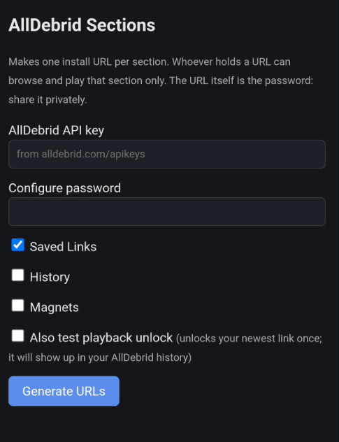
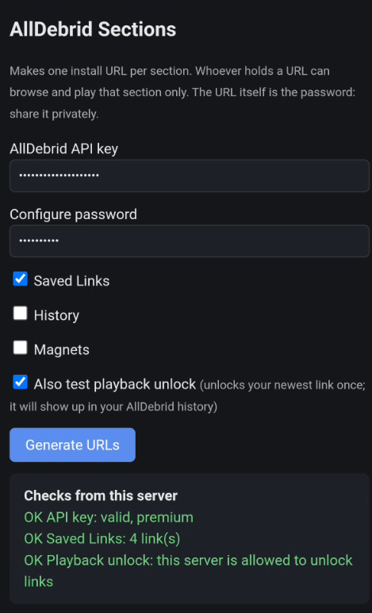

# alldebrid-section-splitter

**Split your AllDebrid account into separate Stremio / Nuvio addon JSONs, one per section, like (Saved Links or History or Magnets) without exposing everything else.**

> Unofficial. Not affiliated with, endorsed by, or supported by AllDebrid.

## Why this exists

Addons that search your whole AllDebrid cloud give anyone you share them with access to all of it. This addon makes one install URL per section:

| URL for | The person holding it can |
|---|---|
| Saved Links | browse and play your saved links, nothing else |
| History | browse and play your history, nothing else |
| Magnets | browse and play your ready magnets, nothing else |
| Combined | only the sections you ticked together |

Your API key is encrypted inside the URL. It never appears in the addon manifest.

## Status: what is tested and what is not

| Part | Status |
|---|---|
| Cloudflare Worker (`worker.js`) | **Tested and working** on a real account: configure page, API key check, saved-links listing, and playback unlock all passed (see screenshots below) |
| Automated tests (`npm test`) | Pass, but run against a **fake AllDebrid**, not the real API |
| Home server (`server.mjs`) | **Not tested like this yet.** It only got a local smoke test (page loads, URL generation runs). Not tried against real AllDebrid, behind a tunnel, or with Stremio/Nuvio. Treat it as experimental |
| History and Magnets sections | Written and covered by the mocked tests. Only Saved Links has been confirmed on a real account |
| Stremio / Nuvio apps | Built to the Stremio addon protocol. If a specific app misbehaves, please open an issue and say which app and version |

## Screenshots

The configure page:



The built-in check, run from the server's own IP. Look at this before sharing any URL:



## Read this before you share anything

1. **The URL is the password.** Anyone with a URL can use that section of your account. Share it privately, and never post it publicly or in screenshots.
2. **You cannot revoke a single URL.** Every URL contains the same API key. To cut everyone off, change `SECRET_KEY` (all URLs stop) or delete the API key at alldebrid.com/apikeys. Use a **dedicated API key** for this addon so revoking it breaks nothing else.
3. **Every play is an unlock on your account.** It shows in your AllDebrid history and counts against any per-host quota.
4. **Account-sharing risk.** AllDebrid ties usage to your account and, according to community reports, limits simultaneous use from different IP addresses. Family in your own home (one public IP) is the safe case. Friends or relatives in other homes may get your account flagged or locked, and sharing beyond your household may breach AllDebrid's terms. Hiding the key does not change what AllDebrid sees. You are responsible for how you use this.
5. **AllDebrid may refuse Cloudflare.** AllDebrid's docs say servers can be refused on some endpoints (`NO_SERVER`, `AUTH_BLOCKED`), and a hosting provider reports datacenter IPs being blocked. The configure page tests this for you. If it fails, use the home-server option.
6. **Do not run a public instance for strangers.** A public configure page becomes a tool for testing stolen API keys, and you would be handling other people's keys. Deploy your own copy and keep `CONFIG_PASSWORD` set.

## Deploy on Cloudflare Workers (tested route)

Free plan limits are 100,000 requests a day. Video does not pass through the Worker: it answers with a redirect and your player downloads from AllDebrid directly.

**1. Create a dedicated API key** at alldebrid.com/apikeys.

**2. Make a secret.** A long random string that encrypts the URLs. Use your password manager's generator (32+ characters), or:

- Linux / Mac: `openssl rand -hex 24`
- Windows PowerShell:
  ```
  $b = New-Object byte[] 24; [Security.Cryptography.RandomNumberGenerator]::Create().GetBytes($b); ($b | % { $_.ToString('x2') }) -join ''
  ```

Save it. If you lose or change it, every URL stops working.

**3. Create the Worker.** In dash.cloudflare.com go to Workers & Pages, Create, Start with Hello World, name it, Deploy. Then Edit code, delete everything, paste the contents of `worker.js`, and Deploy.

**4. Add secrets.** Worker, Settings, Variables and Secrets, add both with type **Secret**:

- `SECRET_KEY` = the value from step 2
- `CONFIG_PASSWORD` = a password you will type on the configure page. Optional but strongly recommended; without it anyone who finds your Worker address can use the page

Deploy again if asked.

**5. Generate URLs.** Open `https://<your-worker>.<your-subdomain>.workers.dev/configure`. Enter the configure password and the API key, tick the sections, tick **Also test playback unlock**, and press **Generate URLs**.

**6. Read the checks box.** If everything says OK, continue. If you see `AUTH_BLOCKED`, `NO_SERVER` or `HTTP_403`, AllDebrid is refusing Cloudflare: use the home server below instead.

**7. Install and test yourself first.** In Stremio use **Install in Stremio**, or paste the manifest URL into the addon box. In Nuvio add the manifest URL from its addon settings. The catalog appears under type **Other**. Play something, on your home Wi-Fi and again on mobile data.

**8. Share only the URL for the section you intend to share.**

Generating more URLs does not invalidate old ones. They all stay valid until you change `SECRET_KEY` or delete the API key.

## Run on your own machine (experimental, not fully tested)

Needs Node 18 or newer.

```
SECRET_KEY="32+ random characters" CONFIG_PASSWORD="your-password" PORT=7000 node server.mjs
```

Stremio requires HTTPS for remote addons, so put it behind Cloudflare Tunnel, Tailscale Funnel or Caddy, then open `/configure` on that HTTPS address. Running at home keeps the unlock and the playback on the same home IP, which may help with AllDebrid's IP rules. That is the reason this option exists, and it is the part that has not been proven yet.

## How it works

- `/configure` takes your API key and sections, checks them against AllDebrid, and encrypts `{key, sections}` with AES-GCM into a URL token.
- Every request carries the token in its path. The server decrypts it and refuses anything outside the sections it names.
- Playback links are never taken from the request. The server looks the item up in your own AllDebrid list, then unlocks it only when someone presses play.
- Nothing is stored server-side. There is no database.

## Develop and test

```
npm test
```

Runs `test.mjs` against a mocked AllDebrid. It checks the scoping rules (a Saved Links URL cannot reach History, Magnets, or arbitrary links), tamper handling, and rotation of `SECRET_KEY`.

## Contributing and security reports

Issues and pull requests are welcome. **Never paste a real API key or a real addon URL into an issue.** If you find a way to read a section a URL should not reach, please report it without posting a working URL.

## License

MIT. See `LICENSE`. Provided as is, with no warranty.
